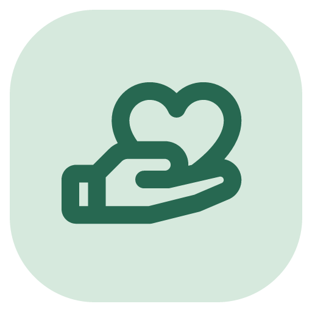
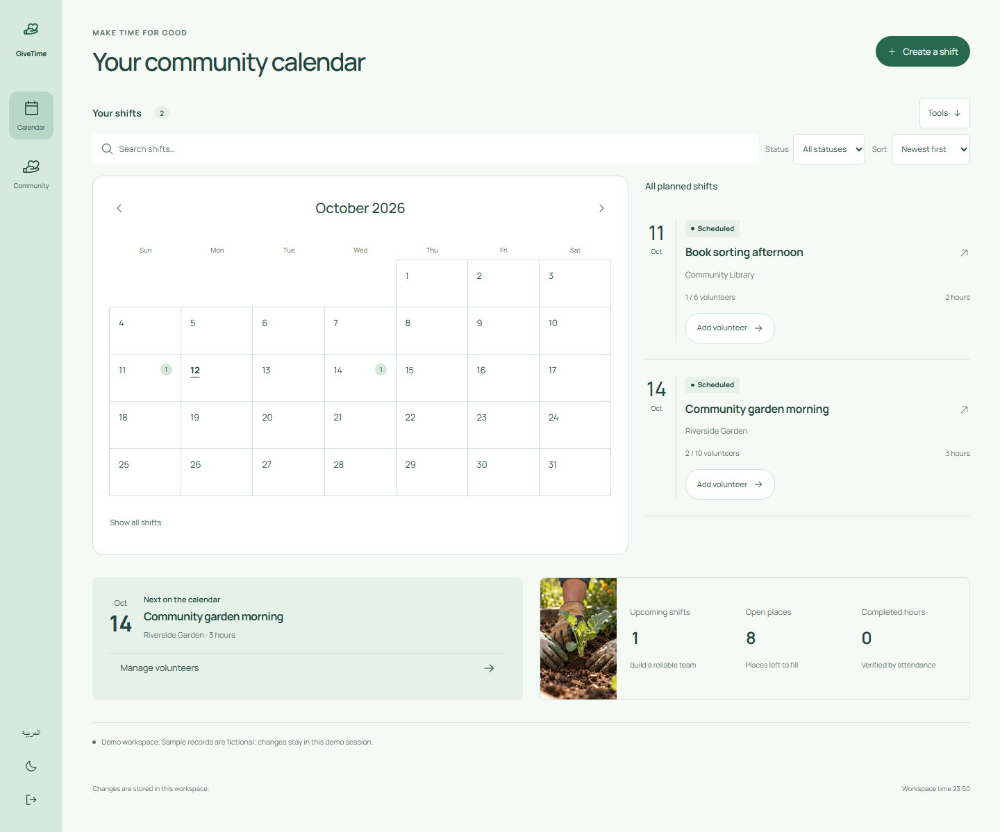
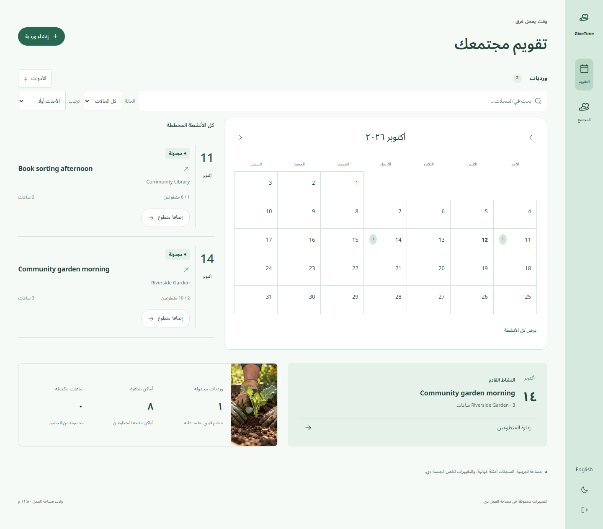
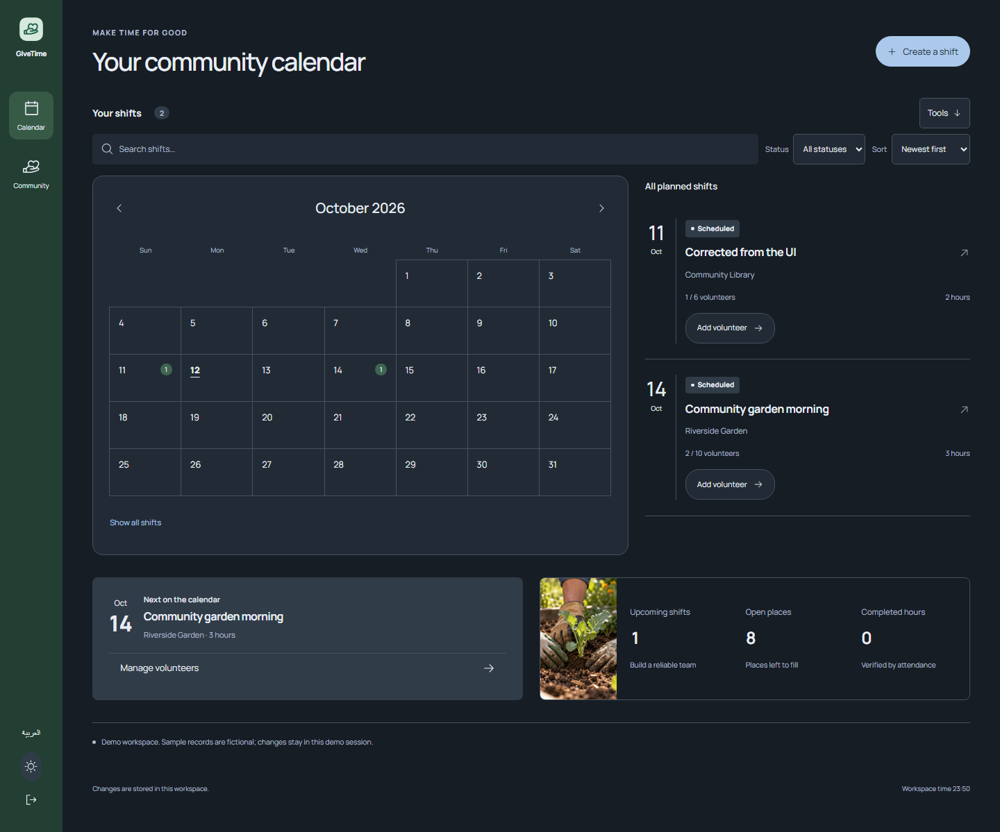

# GiveTime



## Make room for people who want to help.

For volunteer coordinators organizing small community events.



**The calendar is the starting point. Attendance is the evidence.**

[Run locally](#run-locally) · [العربية](#بالعربي) · [Report a bug](https://github.com/Ahmed-Khalil-Mohamed/givetime/issues/new?template=bug_report.yml) · [Suggest an improvement](https://github.com/Ahmed-Khalil-Mohamed/givetime/issues/new?template=feature_request.yml)

[](https://github.com/Ahmed-Khalil-Mohamed/givetime/actions/workflows/quality.yml) [](LICENSE) 

## Plan the shift. Welcome the volunteers. Count the hours.

1. Create a future shift with location, duration and capacity.
2. Add uniquely named volunteers before the shift starts.
3. At or after the start, mark attendance; after the scheduled end, complete the shift to count actual volunteer hours.


## Run locally

Use **Node.js 24 or newer** and npm.

```sh
git clone https://github.com/Ahmed-Khalil-Mohamed/givetime.git
cd givetime
npm ci
npm run dev
```

Open **http://localhost:4315/givetime**. Create an account or explore a separate demo workspace. For a production build, run `npm run build` then `npm start`.

Each checkout owns its dependency lockfile, server, tests and SQLite storage. The browser process uses `data/givetime.sqlite` and the `givetime_session` cookie. [Deployment and backups](docs/DEPLOYMENT.md).

## Behind the workflow

- Capacity is enforced centrally and duplicate names are rejected case-insensitively.
- Attendance cannot be claimed before a shift begins.
- Completed hours count attended volunteers only, multiplied by scheduled duration.

## More of the interface

<details>
<summary>Arabic workspace / الواجهة العربية</summary>



</details>

<details>
<summary>Dark workspace</summary>



</details>

Mint navigation rail, a dominant interactive month calendar, an adjacent dated agenda and an impact strip below. Selecting a day filters the agenda; month controls and reset stay visible.

Screenshots show the actual interface with fictional demonstration records. [Design notes](DESIGN.md) · [Image and icon provenance](ASSETS.md).

## Checks you can run

```sh
npm run format:check
npm run check
npx playwright install chromium
npm run test:e2e
npm audit
```

Capacity, duplicates, attendance timing and completion timing. Local project results are in [VERIFICATION](docs/VERIFICATION.md).

The [Quality workflow](https://github.com/Ahmed-Khalil-Mohamed/givetime/actions/workflows/quality.yml) runs on Windows and Linux. The badge above reports the live result. Local evidence, test counts and known validation limits are documented in [VERIFICATION](docs/VERIFICATION.md).

## Current boundaries

No volunteer self-service portal, identity verification, background checks, attendance evidence uploads, or calendar integration.

The sample records are fictional. Interview intended users and measure task completion before claiming proven impact. A useful next study is to compare the complete workflow with the person’s current spreadsheet or paper process.

## بالعربي

تنسيق ورديات المتطوعين دون تجاوز السعة، وتسجيل الحضور وساعات التطوع المكتملة.

بدّل اللغة من زر «العربية». البيانات التجريبية أمثلة وليست سجلات مستخدمين حقيقيين. [دليل التشغيل بالعربي](START-HERE-AR.md).

## Contribute and report

Use the [bug report](https://github.com/Ahmed-Khalil-Mohamed/givetime/issues/new?template=bug_report.yml) for a reproducible problem, or the [feature request](https://github.com/Ahmed-Khalil-Mohamed/givetime/issues/new?template=feature_request.yml) to explain a missing workflow. Reports in Arabic and English are welcome. Include the version, expected result and steps; use fictional records and redact personal data.

[Contribution guide](CONTRIBUTING.md) · [Private security reporting](SECURITY.md) · [Changelog](CHANGELOG.md) · [API](docs/API.md) · [Architecture](docs/ARCHITECTURE.md)

## License

[MIT](LICENSE). Third-party packages, fonts and icons retain their own licenses; see [THIRD-PARTY-NOTICES](THIRD-PARTY-NOTICES.md).
